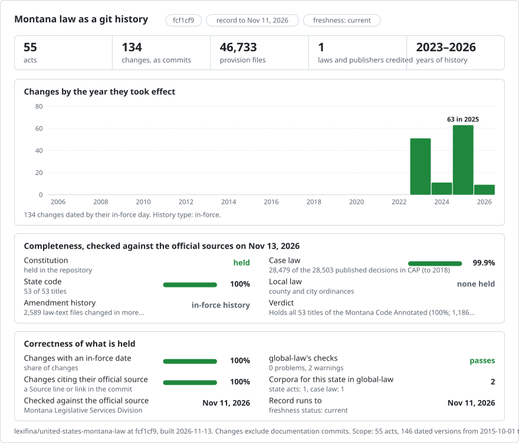

# Montana: law history in git

<picture>
<source media="(prefers-color-scheme: dark)" srcset="data/effort-dark.svg">

</picture>

Part of [lexifina/global-law](https://github.com/lexifina/global-law), one git history for every country's law: this is the law of Montana, United States, which global-law reads at `united-states/montana/acts/`.

The Constitution of Montana and the Montana Code Annotated as a git repository: one file per section, committed with the official publisher named as author. It follows the shared design of [lexifina/global-law](https://github.com/lexifina/global-law).

**What is in it now**

| Folder | Act | Versions | History |
| --- | --- | ---: | --- |
| `constitution/` | Constitution of the State of Montana | 1 or more | First build (2026-10-28); the 2023 and 2025 editions are being added |
| `title-35-corporations/`, `title-45-crimes/`, `title-70-property/` | Titles 35, 45 and 70 | 1 or more | Same |
| `title-*/` | Every other title of the Montana Code Annotated, one folder per title | 2 or more | The 2023 edition (from 2023-10-01), the 2025 edition (from 2025-10-01), and forms printed to take effect later, on their days |

Titles are added in parts from 10 November 2026, as they are retrieved; `data/versions.json` lists what each commit holds. Session laws and administrative rules are not in it.

## Where the text comes from

The Legislative Services Division publishes the Montana Code Annotated as one static HTML page per section at <https://mca.legmt.gov/bills/mca/index.html> (the 2025 edition; its header reads "Updated August 2026") and keeps earlier editions on the same host (<https://mca.legmt.gov/bills/2023/mca/index.html>). Pages were fetched one at a time, at most two a second. Each section keeps its catchline, its text and the History note naming the session laws behind it. Compiler's comments and cross-references are not taken.

## Dates

- Each edition holds the law enacted through that year's regular session. Under MCA 1-2-201(1)(a) a statute "takes effect on the first day of October following its passage and approval unless a different time is prescribed", so the 2023 edition is dated **1 October 2023** and the 2025 edition **1 October 2025**. Laws that took effect earlier in those years appear on 1 October: later than they took effect, never earlier.
- Where an edition prints a section in two forms ("(Temporary -- effective until June 30, 2027)" and "(Effective July 1, 2027)"), each version takes the form in force on its day, and the act gets another version on the day the later form takes effect. Versions dated after the last build day are added when their day comes.
- Forms printed "effective on occurrence of contingency" are left out: the code does not say whether the contingency occurred.
- Changes made between editions (special sessions, constitutional amendments approved at an election) appear with the next edition, later than they took effect.
- The first build (28 October 2026: the Constitution and Titles 35, 45 and 70) was dated by its retrieval day; its commits stay, and any corrections to them are separate commits marked `Kind: correction`.
- The first commit of each act is credited to the Legislative Services Division as "oldest version available".

## What it does not show

- Most title histories begin with the 2023 edition. Title 67 also includes the official 2017 and 2019 editions. The 2021 edition remains outside this record, so continuous coverage across that interval is not asserted.
- Contingent forms of sections (above).
- Compiler's comments, cross-references and other annotations; session laws; rules.
- Nothing here is an official publication: the printed MCA prevails over the Internet version.

## How it is checked

- Every unit is read back from git on its day and compared with the corpus (`tools/check_repo.py`; results in `REPRODUCE.md`).
- Each source is identified by its sha256, in `data/versions.json`.
- Lexifina's code rebuild the corpus from saved copies of the official pages.

## What "author" means

The first commit of each act is authored by the publisher (the Montana Legislative Services Division), as the oldest version available. Later versions are the publisher's later editions. The committer is always Lexifina.

## Earlier Title 67 texts

The official 2017 edition is dated 1 October 2015, the effective day of its latest cited amendment, Chapter 220, Laws of 2015 (HB 99). The official 2019 edition is dated 1 July 2019 under section 16 of Chapter 455, Laws of 2019 (HB 661). The official session-law volumes establish these dates. Both texts retain every listed section and its History note. They were added through labelled correction commits; the previously published commits remain intact.
